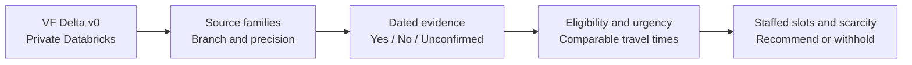
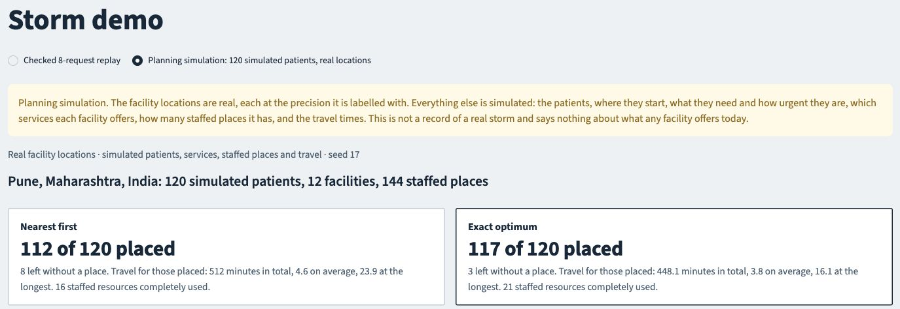

# CMU × Databricks Datathon · Fall 2026

A community health worker in Jaipur needs to find dialysis for a patient. Which facility should they verify first? Find care shows the evidence behind a nearby result and what still needs checking. Before a referral, confirm the correct branch, the service and a staffed appointment.

[Open the live Databricks app](https://vf-find-care-7474658456464525.aws.databricksapps.com/) (sign-in and app access required) · [Root submission notebook](submission.ipynb) · [Download the verified offline notebook](https://github.com/vzhu08/databricks-datathon/raw/3ef5079e36ec15d47b7709e2ef359641ceb4a25e/submission.ipynb)

**National result.** Outside evidence places a named facility in a supported area for **7,895 of 10,088 original Virtue Foundation (VF) records (78.3%)**. [Exploration](#exploration) · [Modeling](#modeling) · [Impact](#impact)

## Try the hosted demo

The app opens on **Check symptoms** with the assessment provider off. An experimental Databricks assessment provider is optional and requires separate operator setup and consent.

1. **Find care (demonstration)** → **Look up the example records** → **Dialysis near Jaipur, Rajasthan** → **Why this finding?**. The fictional result is about **6.7 km away in a straight line**. Its procedures field names dialysis at North Campus, with physical branch, entrance and service date still unverified. Use that record as a lead to check before travel.
2. **Recommend a campus** → **Routine dialysis: keeps a scarce station free**. The example uses simulated minutes and recommends fictional Campus B in both the result and referral note. The separate normal form defaults to TomTom ordinary-car traffic in the signed-in presenter. It sends one bounded batch on **Find a facility**, using simulated endpoints. The result shows the request time and supplier notice. Unavailable road time stays unavailable.
3. **Storm demo (simulated)** → **Planning simulation: 120 simulated patients, real locations** for the Pune comparison. **Checked 8-request replay** is the smaller, fully fictional comparison.

Verified on **November 22, 2026**, using Databricks Free Edition, deployment `01f1e691dbe61f44b15964084cc46203`, source `94b6443`. The real VF SQL run used the same workspace. The notebook runs offline and includes a separate invented-site control. [Edition and VF SQL verification](https://github.com/vzhu08/databricks-datathon/issues/336#issuecomment-7082010831) · [Hosted acceptance](https://github.com/vzhu08/databricks-datathon/issues/304#issuecomment-7082157852) · [Notebook replay](https://github.com/vzhu08/databricks-datathon/issues/307#issuecomment-7082076850)

To run the synthetic app locally from the repository root:

```sh
python -m pip install -r app/requirements.txt
FIND_CARE_DATA=demo streamlit run app/app.py
```

[Local walkthrough and configuration](app/README.md#operator-walkthrough)

## Exploration

### How many VF facilities can we locate?

**7,895 of 10,088 original Indian VF rows (78.3%)** identify a named facility in a supported area, up from **3,144 (31.2%)**. The new rules added **4,751 rows**, and **2,193** remain unresolved. The additions comprise 1,538 registry-area matches, 2,181 further rows with agreeing coordinates under 1 km, and 1,032 further named map listings in the same area. Those three groups are exclusive.

Across the full edition, **6,562 (65.0%)** have a registry-area match or agreeing coordinates. The registry reaches 2,662 and the coordinate check reaches 5,375, with overlap. For 3,715 of the coordinate agreements, all outside point witnesses may share a source with VF. These figures measure ability to find the named facility in its area. Actual building accuracy and entrance location have separate evidence requirements. [National replay](https://github.com/vzhu08/databricks-datathon/issues/57#issuecomment-7081461436) · [Verified judge-display input for #324](https://github.com/vzhu08/databricks-datathon/issues/302#issuecomment-7081550540)

### How often can an outside source corroborate a VF capability mention?

**The 50% target applies separately to the VF rows mentioning each capability.** Each numerator counts original rows where an outside record supports that same capability at the matched facility. Each denominator includes all identified VF mentions of that capability in the five source fields, including rows with unresolved geography. Multiple outside listings count once per original row and capability. A facility can appear in several rows of the table.

| Capability | VF mentions with outside support | Coverage |
| --- | ---: | ---: |
| Dental care | 1,526 / 4,481 | 34.1% |
| Blood banking | 114 / 567 | 20.1% |
| Eye care | 564 / 3,000 | 18.8% |
| Cancer care / oncology | 186 / 2,370 | 7.8% |
| Radiotherapy (licensed centre) | 38 / 269 | 14.1% |
| Dialysis | 17 / 1,047 | 1.6% |
| MRI | 0 / 949 | 0.0% |
| Trauma care | 12 / 1,042 | 1.2% |

Dental care, blood banking and eye care together have **2,168 distinct VF rows** with outside support. Of the 1,526 dental matches, 1,356 have a coded category, service field or roster entry and 170 rely on a specialist facility title. Blood banking uses named directory entries and current blood stock is unknown. The AERB radiotherapy result reflects licensure in the June 5, 2026 roster. Present treatment delivery or machine uptime requires further evidence. Overture can share upstream sourcing with VF. Registry- and programme-based matches should carry the scope of their source.

For dialysis, MRI and trauma, **801, 447 and 896** rows respectively have affirmative VF *or* outside signals. Those are a separate preview measure across all 10,088 originals. The values in the table above (**17, 0 and 12**) answer the outside-corroboration question on the VF mention cohorts. The current three-service operational ledger remains 30,264 unconfirmed decisions. [Three-service evidence](https://github.com/vzhu08/databricks-datathon/issues/58#issuecomment-7081580366) · [Corrected denominator](https://github.com/vzhu08/databricks-datathon/issues/58#issuecomment-7081687576) · [Specialty comparison and private readback](https://github.com/vzhu08/databricks-datathon/issues/58#issuecomment-7081734491)

<details>
<summary>Other measured capabilities and procedures, including zero matches</summary>

| Capability | VF mentions with outside support | Coverage |
| --- | ---: | ---: |
| Orthopedics | 207 / 3,888 | 5.3% |
| Cardiology | 198 / 3,247 | 6.1% |
| Maternity | 196 / 4,607 | 4.3% |
| Pediatrics | 180 / 3,573 | 5.0% |
| Dermatology | 160 / 2,428 | 6.6% |
| Fertility care | 157 / 1,474 | 10.7% |
| Ayurveda | 147 / 508 | 28.9% |
| Outpatient care | 137 / 4,255 | 3.2% |
| Laboratory services | 112 / 1,364 | 8.2% |
| Homeopathy | 74 / 355 | 20.8% |
| Kidney transplant programme | 62 / 448 | 13.8% |
| General surgery | 61 / 3,365 | 1.8% |
| Physiotherapy | 53 / 1,259 | 4.2% |
| Audiology | 36 / 352 | 10.2% |
| Emergency care | 35 / 2,772 | 1.3% |
| Intensive care | 29 / 2,295 | 1.3% |
| Liver transplant programme | 24 / 158 | 15.2% |
| Speech therapy | 11 / 177 | 6.2% |
| Prosthetics | 10 / 428 | 2.3% |
| Addiction treatment | 9 / 132 | 6.8% |
| Naturopathy | 9 / 57 | 15.8% |
| Ultrasound | 9 / 2,051 | 0.44% |
| CT | 8 / 1,482 | 0.54% |
| Pharmacy | 8 / 1,083 | 0.74% |
| X-ray | 8 / 2,474 | 0.32% |
| Ambulance | 7 / 1,184 | 0.59% |
| Heart transplant | 6 / 74 | 8.1% |
| IVF | 6 / 855 | 0.70% |
| Eye bank | 5 / 78 | 6.4% |
| Inpatient care | 5 / 1,874 | 0.27% |
| Occupational therapy | 5 / 106 | 4.7% |
| Cornea transplant | 4 / 180 | 2.2% |
| Acupuncture | 3 / 48 | 6.3% |
| LASIK | 3 / 499 | 0.60% |
| Pancreas transplant programme | 3 / 16 | 18.8% |
| Hospice | 2 / 175 | 1.1% |
| Blood transfusion | 1 / 93 | 1.1% |
| Cataract surgery | 1 / 700 | 0.14% |
| Chiropractic | 1 / 16 | 6.3% |
| IUI | 1 / 477 | 0.21% |
| Lung transplant | 1 / 44 | 2.3% |
| Acupressure | 0 / 21 | 0.0% |
| Blood apheresis | 0 / 65 | 0.0% |
| Blood storage | 0 / 37 | 0.0% |
| Chemotherapy | 0 / 290 | 0.0% |
| Dental implants | 0 / 1,494 | 0.0% |
| Haematology lab | 0 / 9 | 0.0% |
| Hair transplant | 0 / 239 | 0.0% |
| ICSI | 0 / 375 | 0.0% |

Ayurveda has 147 matches, of which seven have a coded or registry-system match. The remainder depend on a specialist facility title. Transplant programme rows may be supported by an organ-specific centre registration. A recorded zero means that this comparison found no qualifying outside match. The largest measured share across the full VF mention cohorts is dental care at 34.1%.

</details>

### How we used sources collected for other purposes

- **Quarterly stroke-care awards can supply a date.** The World Stroke Organization and Angels Initiative recognize hospitals for measured stroke-care performance. We indexed each Indian award by hospital label, quarter and tier. That produced 545 hospital-quarter awards under 102 hospital labels from 2019 Q2 through 2026 Q3. Seven labels matched names on 11 VF rows after normalization. We retained those as leads for checking a hospital’s stroke programme. The awards do not resolve a branch, distinguish thrombolysis from thrombectomy, or establish availability today. [Award criteria](https://www.world-stroke.org/what-we-do/education-and-research/improving-access-to-quality-stroke-care/wso-awards) · [National matching receipt](https://github.com/vzhu08/databricks-datathon/issues/239#issuecomment-7080899299)
- **A radiation regulator and a cancer registry answer different questions.** We matched the institution name and postal PIN in the Atomic Energy Regulatory Board’s June 2026 roster of 802 licensed radiotherapy centres. Of 269 VF rows mentioning radiotherapy, 38 matched a licensed centre. Separately, ICMR’s hospital-based cancer registry recorded treatment actually given during 2012–14. Seven VF rows matched reporting institutions by name, city and state. The licence supports a licensing claim; the ICMR record supports a historical activity lead. Neither establishes machine uptime or present treatment delivery. [AERB roster](https://www.aerb.gov.in/images/PDF/Radiotheraphy/RSD3.pdf) · [ICMR institution tables](https://www.ncdirindia.org/All_Reports/HBCR_REPORT_2012_2014/ALL_CONTENT/Printed_Version.htm) · [Coverage receipt](https://github.com/vzhu08/databricks-datathon/issues/58#issuecomment-7081734491)
- **Organ registrations distinguish transplantation from retrieval.** We matched hospitals to the National Organ and Tissue Transplant Organization register using the named facility, its location, its registered role and the specific organ. A retrieval-only registration cannot satisfy a transplant claim. The programme comparison supported 62 of 448 VF kidney-transplant mentions and 24 of 158 liver-transplant mentions. Those figures measure registered programme evidence. Procedure volume, a staffed team and current availability each require additional evidence. [NOTTO register](https://notto.mohfw.gov.in/hospitals) · [National source receipt](https://github.com/vzhu08/databricks-datathon/issues/239#issuecomment-7081110138)
- **A blood bank inside a hospital needs a host match.** We joined historical blood-bank directory records to the named hospital and its area. A nearby collection site, separate storage unit or general transfusion mention could not supply that link. We counted repeated National Health Portal records once per VF row. The outside directory evidence supported 114 of 567 VF mentions. Blood-group stock remains unknown. [Blood-bank comparison](https://github.com/vzhu08/databricks-datathon/issues/58#issuecomment-7081734491)
- **An address can be usable while a precise pin is uncertain.** We compared named registry and map records at locality, landmark and PIN level. Coordinate-free listings could still support the written area. For nearby points we used agreement under 1 km and tracked possible shared VF/map sourcing. This raised supported search areas from 3,144 to 7,895 of 10,088 original VF rows. It gives a patient a facility name and an area to search; a verified entrance and an available service require their own evidence. [Location rule and national replay](https://github.com/vzhu08/databricks-datathon/issues/57#issuecomment-7081461436)

## Modeling

### From source record to recommendation

The first three stages build evidence from the real dataset. The last two use modeled inputs in the storm comparisons. The exercise uses evidence to decide which claims can support a lookup, then demonstrates allocation on separate inputs.



We pin the Virtue Foundation snapshot and evidence editions in private Databricks, preserving every original occurrence and key for reproducibility. We compare facility names, addresses and other identity cues to resolve the branch. A locality, postal area or district can support a directory result. Routing needs a defensible destination point. Multiple listings copied from the same publisher count as one origin. [Implementation plan](docs/implementation/PLAN.md) · [Matching and validation](docs/implementation/VALIDATION_RESEARCH.md)

Service evidence records who made the claim, where it appears, which campus it refers to, and when it applies. **Yes** requires reviewed evidence of onsite service at the identified campus. **No** requires a reviewed statement of absence or referral elsewhere. Missing dates, equipment inventories, claims about another campus and unresolved disagreements can leave the result **Unconfirmed**. Even a confirmed service needs a separate staffed-capacity check before travel. [Service rules](docs/implementation/SERVICE_STATUS.md)

The allocation policy is deterministic given an urgency, time limit, comparable travel times and staffed resource pools. The highest-urgency request takes the fastest feasible option. A less urgent request can take a bounded detour to preserve the last reachable specialist slot. Unknown or stale capacity does not supply a slot. A missing comparison can make scarcity indeterminate and withhold the detour. An optional TomTom adapter supplies ordinary-car travel estimates in the routing work. The hosted storm uses a fixed travel matrix. [Policy and travel design](docs/implementation/ROUTING_AND_SURGE_DEMO.md) · [Optional routing adapter](https://github.com/vzhu08/databricks-datathon/pull/310)

### Worked example · dialysis near Jaipur

The catalogue keeps explicit service mentions within the requested distance and shows them nearest first. The fictional North Campus phrase qualifies as a direct mention. A related specialty by itself is a weaker lead, and the reported map point does not establish a building or entrance. The “Why this finding?” panel shows which record field supports the result and which branch and date checks remain open.

In the separate simulated recommendation, Campus A is the fastest feasible option at **8 minutes**. The routine request goes to Campus B in **12 minutes**, within the 10-minute detour limit, to preserve A’s last reachable monitored slot. The highest-urgency monitored request can then take A. In the checked eight-request replay, nearest first places **7/8**, urgency-aware places **8/8**, and the first routine request adds **four minutes** in total. Both policies process requests as they arrive. [Pinned replay data](contracts/fixtures/storm_replay.json) · [Reproduce the simulation](app/simulation/README.md)

## Impact

For the health worker, the next step is to confirm the campus and patient entrance, then ask whether the service is running and a staffed appointment is available. A match or a modeled recommendation gives a starting point for that check.

For the district planner, the **Pune edition 1** comparison uses 12 public facility locations and the same 120 simulated requests and 144 simulated staffed slots over six hours. Eight sites have mapped points and four use campus anchors. Patients, starting points, service capability, staffing and travel are modeled. Travel uses straight-line geodesic distance at an assumed **30 km/h**. The exact planner sees the full shift and minimizes unmet highest, time-sensitive and routine requests in that order, then minimizes modeled travel. Nearest first commits each request to the fastest compatible slot as it arrives. [Public geography recipe](https://github.com/vzhu08/databricks-datathon/pull/332) · [Independent allocation replay](https://github.com/vzhu08/databricks-datathon/issues/323#issuecomment-7081879579)

| Simulated measure | Nearest first | Exact offline plan |
| --- | ---: | ---: |
| Assigned a feasible staffed slot | 112 / 120 | 117 / 120 |
| Highest urgency assigned | 19 / 25 | 22 / 25 |
| Time-sensitive assigned | 42 / 44 | 44 / 44 |
| Routine assigned | 51 / 51 | 51 / 51 |
| Unmet, all with compatible slots exhausted | 8 | 3 |
| Modeled travel for the 110 requests placed by both policies | 497.8 min | 395.4 min |

For example, nearest first took the minute-45 dialysis slot for a routine request 192 modeled seconds away. The exact plan moved that request to another site at 442 seconds and used the freed slot for a highest-urgency request 38 seconds away. It placed seven requests that nearest first left unmet and left two unmet that nearest first placed, a net gain of five. The travel row compares the same 110 requests. The app’s total travel cards sum different assigned groups. These are feasible modeled assignments. Treatment outcomes and actual staffed availability require separate evidence.



*Pune edition 1, seed 17, as shown in the signed-in presenter at `94b6443`. Facility geography uses public OSM and NHP evidence. © OpenStreetMap contributors.* [Hosted acceptance](https://github.com/vzhu08/databricks-datathon/issues/304#issuecomment-7082157852) · [OpenStreetMap attribution](https://www.openstreetmap.org/copyright)

## What we checked

| Scope | Result and limit |
| --- | --- |
| **Real national dataset** | The frozen Delta v0 replay preserves **10,088 original occurrences**, including duplicate occurrences, with **10,077 distinct upstream IDs**. The directory v4 readback places **2,524** in the campus category, **7,418** in the area-only category and **146** in unresolved. These are directory classes. Route-ready destinations require a separate check. [Directory readback](https://github.com/vzhu08/databricks-datathon/issues/160#issuecomment-7075940482) |
| **Real service evidence** | The independently recounted comparison found **186 external leads** among **30,264 occurrence/service decisions**. All 30,264 remained unconfirmed in that edition. The frozen 30-case sample still awaits independent human review and accuracy measurement. [Replay and readback](https://github.com/vzhu08/databricks-datathon/issues/168#issuecomment-7075091984) |
| **Hosted and checked** | Provider-off symptom screen, synthetic recommendation and referral note, separate record lookup, default TomTom routing on a normal submit, national named-location summary, and Pune edition 1. [Hosted check](https://github.com/vzhu08/databricks-datathon/issues/304#issuecomment-7082157852) |
| **Separate release checks** | The provisional VF-only lookup rule and the evidence-enriched four-class storm scenario have separate acceptance. The standalone notebook's verified earlier 120-request control uses invented sites. [VF-only scope](https://github.com/vzhu08/databricks-datathon/issues/330) · [Storm follow-up](https://github.com/vzhu08/databricks-datathon/issues/323) · [Offline notebook receipt](https://github.com/vzhu08/databricks-datathon/issues/307#issuecomment-7082076850) |

The offline evidence walkthrough uses approved display files. Real source snapshots and Marketplace rows stay outside Git. [Offline walkthrough](app/facility_evidence_demo/README.md) · [Search contract](docs/implementation/SEARCH_CONTRACT.md) · [Release board](docs/implementation/OWNERSHIP.md)

## Submission

The organizer lists Sunday, November 22 at **12:30 p.m. ET** as the tentative deadline for code, analysis, and video. [Event schedule](https://cmudsc.com/datathon-fall2026/) · [Challenge brief](https://docs.google.com/document/d/e/2PACX-1vQxhDNQmgZhPgjG0M6LCb_UXNV8CJryqBNQQuqWfIg_dm40ZU1AYAXzZKViC6haFoCmLNiRVfUSBMjf/pub) · [Submission notebook status](https://github.com/vzhu08/databricks-datathon/issues/307)

## Hackathon Kit

[`kit/`](kit/README.md) contains the complete MIT-licensed upstream snapshot at [`22a5f44`](https://github.com/oliverchennn/hackathon-kit/commit/22a5f44a27375e88ac2cd1754f6976704f725bc5). Start with its [orchestration guide](kit/docs/guides/ORCHESTRATION.md), [collaboration playbook](kit/docs/playbooks/COLLABORATION.md), and [templates](kit/docs/templates/). The Datathon uses the kit's ownership, contracts, handoff, and verification practices.
