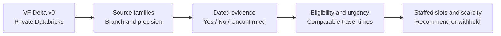

# CMU × Databricks Datathon · Fall 2026

A facility finder for community health workers in India. Given a need such as dialysis, MRI, or trauma care and a starting location, it helps the worker decide which facility to verify before a referral. The result shows nearby candidates, the text behind the match, and which details still need confirmation.

## Try the hosted demo

[Open the presenter app](https://vf-find-care-7474658456464525.aws.databricksapps.com/). It requires Databricks sign-in and app access. The app opens on **Check symptoms** with the assessment provider off. An experimental Databricks assessment provider is optional and requires separate operator setup and consent.

1. Choose **Find care (demonstration)** → **Dialysis near Jaipur, Rajasthan**. The nearest matching fictional facility is about **6.7 km away in a straight line**. This finder uses six invented facilities.
2. Open **Why this finding?**. The panel shows a reported map point, an unverified building and entrance, and a dialysis statement from one synthetic record. Dialysis is **Unconfirmed** because the branch and service date are unknown.
3. Choose **Storm demo (simulated)** → focus **Clock minute** and press **End** to reach minute 20 and compare the two policies. The replay also offers **Play** and **Skip to the result**. The patients, campuses, staffed slots and travel times are fictional.

Hosted check on **November 22, 2026**, at deployment `01f1e68bf66115ec91301e5539001a19`, source `046adf9`. [Release verification](https://github.com/vzhu08/databricks-datathon/issues/319#issuecomment-7081607270) · [Recording walkthrough](https://github.com/vzhu08/databricks-datathon/issues/305)

To run the synthetic app locally from the repository root:

```sh
python -m pip install -r app/requirements.txt
FIND_CARE_DATA=demo streamlit run app/app.py
```

[Local walkthrough and configuration](app/README.md#operator-walkthrough)

## From source record to recommendation

The first three stages build evidence from the real dataset. The last two use synthetic inputs in the storm replay.



We pin the Virtue Foundation snapshot and evidence editions in private Databricks, preserving every original occurrence and key for reproducibility. We compare facility names, addresses and other identity cues to resolve the branch. A locality, postal area or district can support a directory result. Routing needs a defensible destination point. Multiple listings copied from the same publisher count as one origin. [Implementation plan](docs/implementation/PLAN.md) · [Matching and validation](docs/implementation/VALIDATION_RESEARCH.md)

Service evidence records who made the claim, where it appears, which campus it refers to, and when it applies. **Yes** requires reviewed evidence of onsite service at the identified campus. **No** requires a reviewed statement of absence or referral elsewhere. Missing dates, equipment inventories, claims about another campus and unresolved disagreements can leave the result **Unconfirmed**. Even a confirmed service needs a separate staffed-capacity check before travel. [Service rules](docs/implementation/SERVICE_STATUS.md)

The allocation policy is deterministic given an urgency, time limit, comparable travel times and staffed resource pools. The highest-urgency request takes the fastest feasible option. A less urgent request can take a bounded detour to preserve the last reachable specialist slot. Unknown or stale capacity does not supply a slot. A missing comparison can make scarcity indeterminate and withhold the detour. An optional TomTom adapter supplies ordinary-car travel estimates in the routing work. The hosted storm uses a fixed travel matrix. [Policy and travel design](docs/implementation/ROUTING_AND_SURGE_DEMO.md) · [Optional routing adapter](https://github.com/vzhu08/databricks-datathon/pull/310)

## Worked example · simulated storm

A routine dialysis request arrives first. Nearest first chooses Campus A in **8 minutes**. Urgency-aware chooses Campus B in **12 minutes**, preserving A’s monitored slot for the next, highest-urgency request. The demo processes arrivals as they occur. It does not look ahead. At a tighter detour limit, or with no known staffed option at B, the model cannot make that same assignment.


*Hosted replay, storm seed 17, with a 10-minute detour limit. “Served” means assigned a feasible modeled staffed slot during the shift. Extra travel is summed in minutes relative to each policy’s fastest feasible option at assignment. The four minutes come from the first routine request. This is an allocation result for the scenario. Treatment outcomes and live capacity were outside the model.* [Pinned replay data](contracts/fixtures/storm_replay.json) · [Reproduce the simulation](app/simulation/README.md)

## What we checked

| Scope | Result and limit |
| --- | --- |
| **Real national dataset** | The frozen Delta v0 replay preserves **10,088 original occurrences**, including duplicate occurrences, with **10,077 distinct upstream IDs**. The directory v4 readback places **2,524** in the campus category, **7,418** in the area-only category and **146** in unresolved. These are directory classes. Route-ready destinations require a separate check. [Directory readback](https://github.com/vzhu08/databricks-datathon/issues/160#issuecomment-7075940482) |
| **Real service evidence** | The independently recounted comparison found **186 external leads** among **30,264 occurrence/service decisions**. All 30,264 remained unconfirmed in that edition. The frozen 30-case sample still awaits independent human review and accuracy measurement. [Replay and readback](https://github.com/vzhu08/databricks-datathon/issues/168#issuecomment-7075091984) |
| **Hosted and checked** | Provider-off symptom screen, six-facility synthetic finder with result provenance, and the separate storm simulation. [Hosted check](https://github.com/vzhu08/databricks-datathon/issues/319#issuecomment-7081607270) |
| **Merged or prepared for a later hosted check** | The [capacity recommendation helper](https://github.com/vzhu08/databricks-datathon/pull/308) and [TomTom adapter](https://github.com/vzhu08/databricks-datathon/pull/310) are merged. The prepared national location summary covers **7,895 of 10,088** original records under a separate named-location rule. A signed-in check is still required for the [national location summary](https://github.com/vzhu08/databricks-datathon/issues/302) and the [routing provider mode](https://github.com/vzhu08/databricks-datathon/issues/303). |
| **In development** | The [policy-aware finder and referral note](https://github.com/vzhu08/databricks-datathon/issues/304) need a deployed receipt. The hosted finder above demonstrates the catalogue and evidence panel. |

The offline evidence walkthrough uses approved display files. Real source snapshots and Marketplace rows stay outside Git. [Offline walkthrough](app/facility_evidence_demo/README.md) · [Search contract](docs/implementation/SEARCH_CONTRACT.md) · [Release board](docs/implementation/OWNERSHIP.md)

## Submission

The organizer lists Sunday, November 22 at **12:30 p.m. ET** as the tentative deadline for code, analysis, and video. [Event schedule](https://cmudsc.com/datathon-fall2026/) · [Challenge brief](https://docs.google.com/document/d/e/2PACX-1vQxhDNQmgZhPgjG0M6LCb_UXNV8CJryqBNQQuqWfIg_dm40ZU1AYAXzZKViC6haFoCmLNiRVfUSBMjf/pub) · [Submission notebook status](https://github.com/vzhu08/databricks-datathon/issues/307)

## Hackathon Kit

[`kit/`](kit/README.md) contains the complete MIT-licensed upstream snapshot at [`22a5f44`](https://github.com/oliverchennn/hackathon-kit/commit/22a5f44a27375e88ac2cd1754f6976704f725bc5). Start with its [orchestration guide](kit/docs/guides/ORCHESTRATION.md), [collaboration playbook](kit/docs/playbooks/COLLABORATION.md), and [templates](kit/docs/templates/). The Datathon uses the kit's ownership, contracts, handoff, and verification practices.
