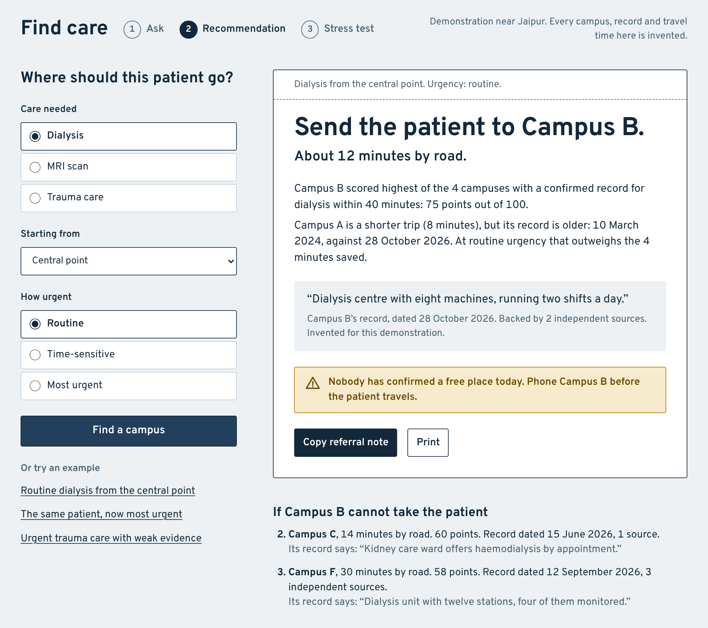
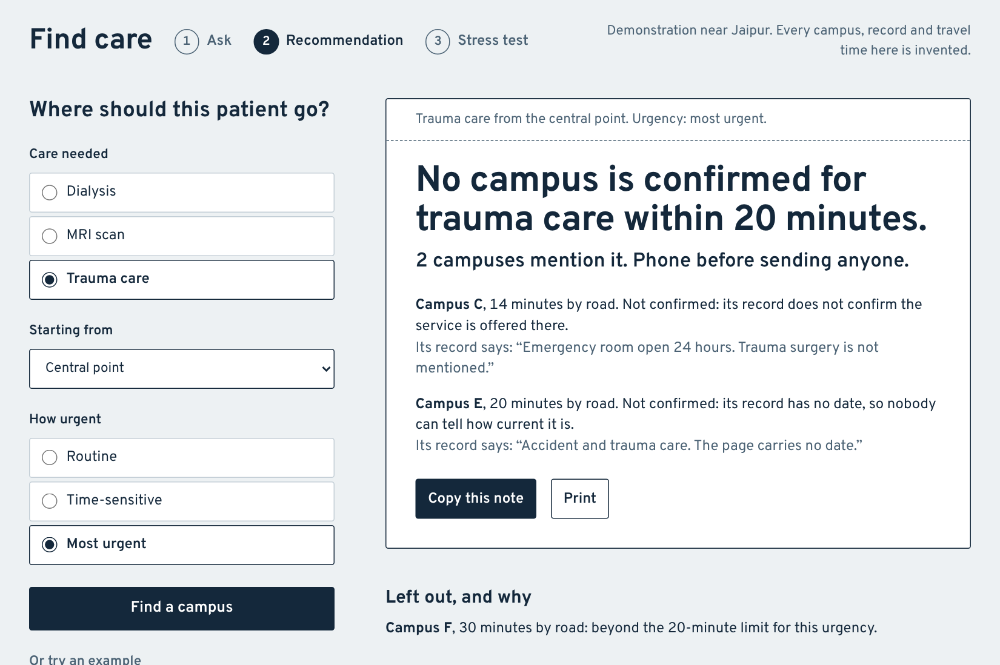
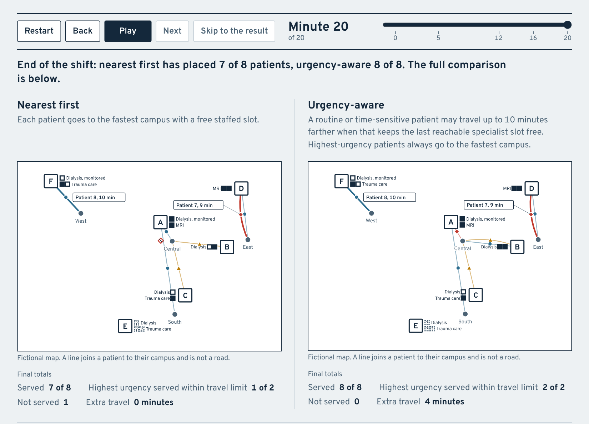

# Find care app

`app.py` is the Streamlit screen for Databricks Apps. It takes a service and a location, typed on
one line as a city or town (with the state after a comma), a six-digit PIN code, or coordinates,
and words what the team's search returns. It follows the
[search contract](../docs/implementation/SEARCH_CONTRACT.md) and never ranks or filters on its own.
`find_care.py` holds the wording and the two rules below as pure functions.

## Check symptoms (the patient screen)

The app opens on **Check symptoms**. Find care is the second choice in the switch at the top of the
page. `patient_ui.py` is the patient screen over the patient runtime in `patient_intake/`
([contract](../contracts/patient_intake/README.md)). It holds no clinical logic. Each time it is
drawn it shows the runtime's current public view for the encounter and nothing else.

| Step | What the patient sees | Runtime call, made once per button press |
| --- | --- | --- |
| Before you start | What is kept, for how long, and that nothing is sent yet. A tick box and Start | `PatientSession.open` after the agreement |
| Describe | Free text in the patient's own words, and an optional age | `edit` |
| Agree to send | Who receives the description. Nothing is sent before this | `consent`, then `assess` |
| Questions | The provider's reading of the patient's words to confirm, doubt or reject, then follow-up questions: one choice, several choices, free text, a list of items each answered on its own, an amount with a unit the patient picks, or a pick from an issued list. An optional question has its own Skip button | `answer`, then `assess` |
| Result | Urgency, the provider's guidance and uncertainty, possible causes with no likelihood, and who assessed it | `view` only |
| Stopped | A provider stop shows the provider's message and nothing else: no urgency, causes or hospital | `view` only |
| Where to go | Only after a completed result, and only from the runtime's reviewed handoff | `confirm`, then `navigate` |

What it will not do:

- **No provider, no assessment.** `patient_ui.compose` is the one place an assessment provider is
  injected, and this repository configures none. The screen says assessment is switched off before
  the patient writes anything, and after a description is saved the runtime itself returns
  `provider_unavailable`. There is no scripted story, sample picker or fixture fallback.
- **No stale result.** An edit, a withdrawn agreement, a failed or out-of-date step, an expiry and
  Start over all leave only what the runtime holds now. The screen keeps no copy of a result.
- **No text left on an idle page.** An open page is told to look again one second after the visit's
  time limit and then shows only the opening notice, with no action from the patient. It is one
  timed check, not a poll. A device that is asleep or offline at that moment clears when it
  reconnects, and the notice says so.
- **No claim that nothing was sent** after a failure, a timeout or an interrupted request. The
  screen says a result could not be confirmed and that the description may have reached the
  provider. "Not sent anywhere" is said only when this server has no provider at all.
- **No claim about a provider's copy.** Start over and expiry are described as clearing this
  server's copy. The agree step says that does not delete what a provider has already received.
- **No repeat on redraw.** Runtime calls happen in button handlers. Drawing the page again never
  repeats a consent, an assessment or an answer.
- **No patient text outside the encounter.** Nothing goes in the URL, browser storage, a download
  or a debug panel. Once a description is saved its widget copy is deleted, so the encounter store
  (cleared on Start over and after 15 minutes) holds the only copy. Handles, continuations, receipts
  and source references stay in the server session.
- **No markup from a provider or a patient.** Their text is shown as plain text.
- **No interpretation claimed.** Under the patient's own words the screen says "Your description has
  not been interpreted."
- **Nothing filled in for the patient.** No unit or choice is preselected, an unanswered optional
  item is left out, a typed amount is sent as typed with no rounding or conversion, and skipping is
  only ever the explicit Skip button. Limits are checked by the runtime, not guessed by the screen.
- **No way forward from an unsupported age or language** except changing the description. A question
  kind the screen does not know is withheld whole.
- **No hospital for an urgent result**, and for a completed one only what the reviewed handoff
  returns. Today that is "no reviewed hospital".
- Pressing "I have read this" is the patient's own confirmation. The screen says it is not a
  doctor's order and books nothing.

Wiring a provider is a change in `compose` by the runtime owner: the adapter, its
`(provider_id, provider_version)` identity and its server-side secrets. The label it returns is the
name the patient is shown before agreeing to send anything. The screen passes `language: "en"` and
the optional age as context, which is all the interview contract accepts today.

Browser checks: `python tests/patient_ui/stand_in.py PORT [VISIT_SECONDS]` starts this same app with
a scripted stand-in provider composed through `compose`, one per visit, and an optional short visit
time limit for watching expiry. Marker words in the description pick the scenario (urgent, stop,
outage, rate limit, malformed reply, unsupported, question loop). The file lists them. It is test
tooling outside `app/` and every reply is invented.

Not on this screen yet: a group-wide "none of these / unknown" action (the question view carries no
marker for it), a paged picker for large catalogs, any context beyond age and English, and a
reviewed hospital list (the handoff has no reviewed release to read).

Tests: `python3 -m unittest tests.patient_ui.test_patient_ui`. The wording tests run anywhere. The
screen tests need Streamlit and drive the real session store, interview reducer, service and
handoff, with a scripted stand-in provider and invented statements. They say nothing about a real
provider or about clinical accuracy.

## Data mode

The mode is named at the top of the screen (`Data: demonstration`, `Data: real records` or
`Data: not available`) and is decided by `find_care.data_mode` from the app's settings:

| Setting | Mode |
| --- | --- |
| `FIND_CARE_DATA=demo`, or none of the five warehouse settings present | Demonstration on the six invented facilities in `demo_facilities.json` |
| `FIND_CARE_DATA=warehouse`, or any of the five warehouse settings present | Real records through `search_warehouse` |

The five warehouse settings are `DATABRICKS_WAREHOUSE_ID`, `DATABRICKS_PREPARED_TABLE`,
`DATABRICKS_HOST`, `DATABRICKS_CLIENT_ID` and `DATABRICKS_CLIENT_SECRET`. Databricks Apps supplies
the last three to every app, so a deployed app is a demonstration only because `app.yaml` says
`FIND_CARE_DATA=demo`. A warehouse that is only partly configured, including the host or the
credentials on their own, is a setup problem and never a fallback to invented data. The screen
names each missing setting without repeating any value, and stops.
A table that cannot be read gives "The facility records cannot be reached right now."

## What each mode shows

**Demonstration.** One facility, the exact words from its invented record with the field they came
from, its record sources, what is not confirmed, up to two backups, a referral note to copy or
save, and the request and response under Technical details.

**Real records.** The v0 search answers `ok` when a record states the service and orders by
straight-line distance. That is not enough for a referral, and the team's verified count of
eligible real destinations is zero. So every warehouse response passes through
`find_care.withheld` before anything else sees it. The screen says whether nearby records mention
the service and that none is reviewed and approved. It shows no facility name, place, distance,
record text, source link or identifier, no backup, no referral note, no download, no place-name
choices, and no response payload: Technical details holds the request and the status only. The
withheld form is also all that is kept in session state. Lifting this needs an adjudicated
service, a reviewed campus, an approved destination and display-permitted fields through a
verified interface, and is Oliver's decision.

The screen has no print control of its own in either mode.

In both modes the form always shows the request the answer is for: an example fills the form before
it searches. When the form is changed after an answer, the answer is marked as being for the earlier
request and greyed, and the backups, the referral note and the download are taken away until Find a
facility is pressed again.

## Run it

```
pip install -r app/requirements.txt
streamlit run app/app.py
```

To deploy, use `app/` as the app's source folder: `app.yaml` runs `streamlit run app.py` there and
sets `FIND_CARE_DATA=demo`. The demonstration facilities are inside `app/` so that folder is
enough on its own. `demo_facilities.json` is a copy of `contracts/fixtures/search.json`, and a
test fails if the two differ.

Not done here: no deployment has been made, and the screen has not read the real table. Live
deployment and publication need a separate decision.

## Operator walkthrough

For whoever runs the demo or records the video. Everything in this section uses invented
facilities. Nothing here needs a Databricks account.

### Two separate things to show

| | Offline pages | Streamlit app |
| --- | --- | --- |
| Source folder | `app/storm_ui/` | `app/` |
| Start it | Open `app/storm_ui/index.html` in a browser. No server or install. | `streamlit run app.py` from `app/` (below) |
| What it is | Find care with urgency (campuses A to F, travel in minutes), then the storm stress test (`replay.html`) | The screen packaged for Databricks Apps (six invented facilities, straight-line distance) |
| Data | Answers and replays computed ahead of time from invented records | `demo_facilities.json`, or the prepared table when configured |

They share no code path at run time and their invented facilities differ, so do not present one
as the other. The storm replay exists only in the offline pages.

### Start the Streamlit demonstration

```
cd app
pip install -r requirements.txt
FIND_CARE_DATA=demo streamlit run app.py
```

`FIND_CARE_DATA=demo` is the explicit synthetic mode, and `app.yaml` sets the same value for a
deployed app. Expected startup: Streamlit prints a local address, and the page shows the title
**Find care**, a band reading **Data: demonstration. This screen is running on six invented
facilities, not the real records.**, and a form already filled with Dialysis, "Jaipur, Rajasthan"
and 50 km.

| Do this | Expect |
| --- | --- |
| Press **Find a facility** | "Send the patient to Example Regional Hospital.", about 6.7 km away, with the quoted record text, its field and its source |
| Press the example **Dialysis within 2 km of PIN 302001** | "No facility within 2 km clearly offers dialysis." Nothing is recommended. This is the weak-evidence result |
| Change the form after an answer | The answer is greyed and marked as being for the earlier request |

### Recognising incomplete configuration

If the screen opens with a red box, **Data: not available. This app is set to read the real
facility records, but its setup is incomplete.**, followed by one line per missing setting and no
form, the app is not in demonstration mode and at least one of the five warehouse settings is
missing or malformed. It never falls back to invented data on its own. For a demonstration, set
`FIND_CARE_DATA=demo` and restart. The settings are listed under [Data mode](#data-mode).

### What has been run, and what has not

Run locally, on invented facilities only: both offline pages in a browser; the Streamlit
demonstration through its test harness and as a real server started from a copy of `app/` alone
with the command in `app.yaml`; and the real-records screen against a mocked warehouse that
returns the invented facilities.

Not run: no deployment to Databricks Apps, no read of the prepared table by this screen, and no
start with the settings Databricks supplies. Those wait for an authorised live deployment, which
is Oliver's decision.

If that deployment is made from a workspace folder holding a copy of `app/`, no Git access is
involved. If it is made from this repository, the repository is private, so the app's service
principal needs a Git credential and the source code path must be `app`. Both routes are in
Databricks' [Deploy a Databricks app](https://docs.databricks.com/aws/en/dev-tools/databricks-apps/deploy).

### The walkthrough in pictures

Captured from `main` at `9c6f0a6`, 1100 px wide, saved at 1650 px. Every facility, campus, record,
slot count and travel time shown is invented.

**1. Find care, offline.** A routine dialysis request gets one campus, the reason, the record text
behind it and two backups. The rule weighs urgency: at routine urgency a fresher record outweighs
a trip that is 4 minutes shorter.



**2. Weak evidence, offline.** Most-urgent trauma care, where no record confirms the service
within the 20-minute limit. The page recommends nothing and says what each record does say.



**3. Storm stress test, offline.** One simulated storm shift (seed 17, 10-minute detour cap)
played under two rules with the same eight patients. Nearest-first places 7 of 8. The
urgency-aware rule places 8 of 8 by sending routine dialysis Patient 1 to Campus B in 12 minutes
in place of Campus A in 8, which keeps A's last monitored dialysis slot free for the
highest-urgency Patient 2. The cost is 4 extra minutes of travel in total. Developer D's
[clarity receipt](https://github.com/vzhu08/databricks-datathon/issues/90) records the same
figures. This is a simulation on invented slot counts and travel times. "Placed" means the model
found a feasible appointment. It is not a measured patient outcome.



**4. The packaged Streamlit demonstration.** The screen that `app.yaml` starts, in demonstration
mode, after pressing Find a facility.


**5. Real-records mode, mocked.** The same screen set to real records, with a mocked warehouse
that returns the six invented facilities. No real record was read to make this image. It shows
what the screen does when the search finds a matching record: it names no facility.


## Checks

```
python -m unittest tests.find_care.test_find_care
```

Nine wording and rule tests run on the shared fixture. Ten screen tests drive the app through
Streamlit's test harness, including a stub warehouse whose v0 answer is `ok` only because a record
states the service, a half-configured warehouse, a read failure, and a request changed after its
answer. Two more copy `app/` to an empty folder, answer the demonstration example there, and start
the server with the command in `app.yaml`. The twelve tests that need Streamlit are skipped when it
is not installed.

## Design review

Reviewed on 21 November 2026 against a judge's first minutes: find the two inputs, run one request,
ask why and how, then probe weak evidence. Nielsen's ten heuristics, 0 to 4 each, one reviewer
reading the rendered screen at 1366 px and 390 px. No automated detector was run.

| # | Heuristic | Before | After |
| --- | --- | ---: | ---: |
| 1 | Visibility of system status | 2 | 3 |
| 2 | Match with the real world | 2 | 3 |
| 3 | User control and freedom | 2 | 3 |
| 4 | Consistency and standards | 2 | 3 |
| 5 | Error prevention | 1 | 3 |
| 6 | Recognition rather than recall | 2 | 3 |
| 7 | Flexibility and efficiency | 2 | 2 |
| 8 | Aesthetic and minimalist design | 2 | 3 |
| 9 | Error recovery | 3 | 3 |
| 10 | Help and documentation | 2 | 3 |
| | **Total** | **20/40** | **29/40** |
| | Cognitive load checklist failures | 3 of 8 | 1 of 8 |

What was wrong before, in the order a judge would hit it:

1. The location boxes showed "Jaipur" and "Rajasthan" as grey hints that read as filled in, so the
   first press of Find a facility answered "Type the city or town." The demonstration form now
   starts filled, and the first press answers.
2. The examples sat under the form, below the fold. The form is shorter (one location box in place
   of a mode switch and up to two boxes), so they are in the first view, and each one fills the form.
3. The data mode, the screen's main honesty signal, was the faintest text on it. It is a band under
   the title.
4. The answer's parts had the same weight, and the cited record text, which the brief asks for, was
   the greyest. The answer is now the same referral slip as the offline Find care page: the request,
   the facility, the distance, why this facility, what its record says with its field and source,
   then the caveat.
5. An answer stayed on screen unmarked after the form changed, with its referral note still there
   to copy. See the paragraph above.
6. "About 6.7 km in a straight line from the middle of that place." is now "About 6.7 km away, in a
   straight line.", with the approximation said once under the answer.

What still scores low: Enter in the location box does not search, the screen shows no progress
while a warehouse query runs, and on a phone the answer lands below the form and the examples.
